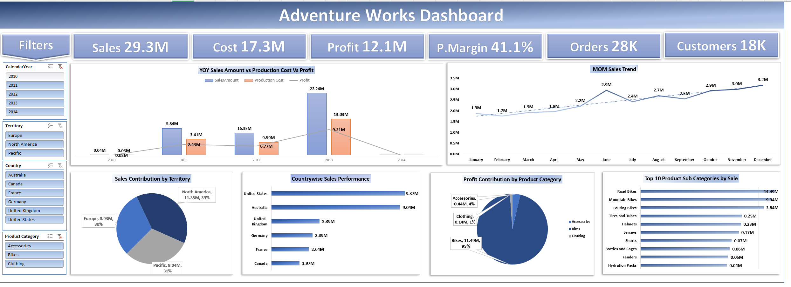
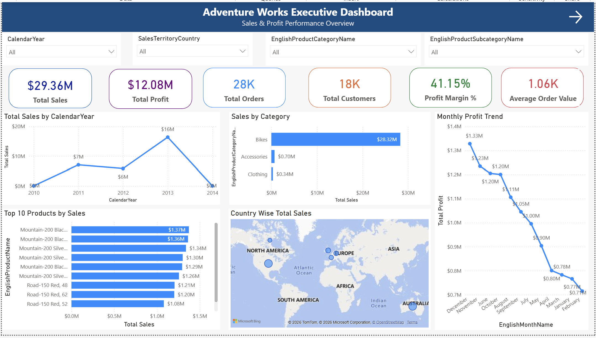
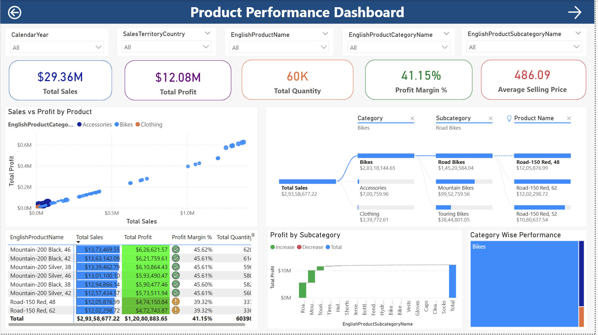
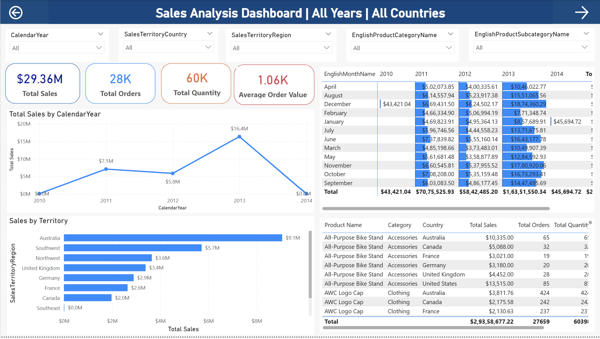
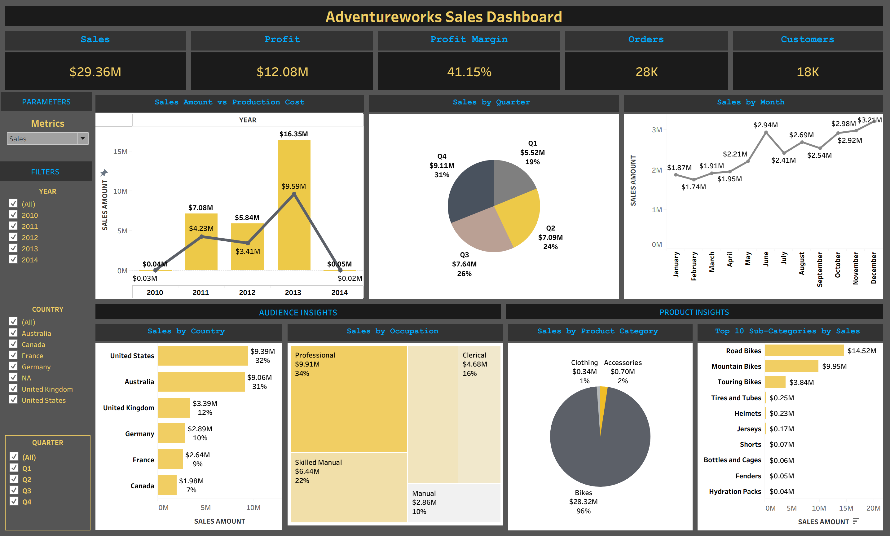

# Adventure Works Business Intelligence & Sales Analytics

### End-to-End Data Analytics Project Using MySQL, Microsoft Excel, Power BI & Tableau

[](https://www.mysql.com/)
[](https://www.microsoft.com/microsoft-365/excel)
[](https://powerbi.microsoft.com/)
[](https://www.tableau.com/)

---

## Project Overview

The **Adventure Works Business Intelligence & Sales Analytics Project** is an end-to-end data analytics project designed to transform sales data into meaningful business insights using four widely used analytics tools: MySQL, Microsoft Excel, Power BI, and Tableau.

The project follows a structured analytical workflow, beginning with relational database management and SQL-based analysis, followed by spreadsheet analytics, interactive Power BI dashboards, and Tableau visualizations.

The objective is to evaluate sales performance, product profitability, customer behavior, and regional performance through KPIs, reports, and interactive dashboards that support data-driven business decisions.

**Project Type:** Business Intelligence & Data Analytics  
**Industry:** Manufacturing / Retail / Bicycle Sales  
**Dataset:** Adventure Works sample business dataset  
**Tools:** MySQL, Microsoft Excel, Power BI, Tableau

---

## Business Problem

Adventure Works Cycles is a multinational bicycle manufacturing and sales company operating across multiple markets. The business needs to understand its historical sales performance and identify opportunities to improve revenue, profitability, customer engagement, and regional growth.

The project addresses the following business questions:

- How is overall sales performance changing over time?
- Which product categories and subcategories contribute most to revenue?
- Which products generate the strongest sales and profitability?
- Which countries and sales territories perform best?
- Which customer segments contribute most to sales?
- How do sales, production costs, and profit compare?
- Which KPIs should management monitor to evaluate business performance?
- How can interactive dashboards make business reporting more accessible?

## Project Objectives

1. Organize sales and dimension data in a relational database using MySQL.
2. Perform SQL-based data preparation, aggregation, and business analysis.
3. Use Excel for data validation, calculated columns, PivotTables, charts, and KPI reporting.
4. Develop interactive Power BI reports using data modeling, Power Query, and DAX.
5. Create Tableau visualizations for exploratory analysis and business storytelling.
6. Build a consistent set of business KPIs across the analytics workflow.
7. Translate analytical findings into actionable business recommendations.

---

## Project Architecture

```text
              ADVENTURE WORKS DATA
                       |
                       v
                MYSQL DATABASE
          Data Storage & SQL Analysis
                       |
                       v
              MICROSOFT EXCEL
       Data Validation, Calculations & KPIs
                       |
                       v
                   POWER BI
        Data Modeling, DAX & Dashboards
                       |
                       v
                   TABLEAU
          Interactive Visual Analytics
                       |
                       v
             BUSINESS INSIGHTS
       Reporting & Decision Support
```

---

## Technology Stack

| Tool | Role in the Project | Key Work |
|---|---|---|
| MySQL | Database management and SQL analysis | Data import, relational tables, joins, aggregations, analytical queries |
| Microsoft Excel | Spreadsheet analytics | Calculated columns, KPI calculations, PivotTables, charts, executive dashboard |
| Power BI | Business intelligence reporting | Data modeling, Power Query, DAX measures, interactive dashboards |
| Tableau | Visual analytics | Worksheets, filters, parameters, dashboard interactions, visual storytelling |

---

# Module 1: MySQL Database & SQL Analytics

## Objective

Establish a structured database for Adventure Works data and use SQL to analyze sales transactions alongside customer, product, date, and territory information.

## Key Activities

- Imported Adventure Works data files into MySQL.
- Worked with fact and dimension tables.
- Organized data for analytical queries.
- Used SQL joins to combine related business information.
- Applied aggregation and grouping to summarize sales performance.
- Analyzed sales by product, customer, territory, and time period.
- Validated imported data and investigated data type and date-conversion issues.
- Prepared the analytical foundation for reporting and dashboard development.

## SQL Concepts

- `SELECT` and `WHERE`
- `INNER JOIN` and `LEFT JOIN`
- `GROUP BY` and `ORDER BY`
- Aggregate functions such as `SUM()`, `COUNT()`, and `AVG()`
- Conditional logic using `CASE`
- Date conversion and formatting
- Data validation and record-count checks

## Example: Sales by Product Category

```sql
SELECT
    pc.EnglishProductCategoryName AS ProductCategory,
    SUM(f.SalesAmount) AS TotalSales
FROM FactInternetSales AS f
JOIN DimProduct AS p
    ON f.ProductKey = p.ProductKey
JOIN DimProductSubCategory AS psc
    ON p.ProductSubcategoryKey = psc.ProductSubcategoryKey
JOIN DimProductCategory AS pc
    ON psc.ProductCategoryKey = pc.ProductCategoryKey
GROUP BY
    pc.EnglishProductCategoryName
ORDER BY
    TotalSales DESC;
```

## Business Value

SQL provides a structured method for retrieving, combining, and summarizing business data. It enables repeatable analysis and supports the preparation of datasets for downstream reporting.

---

# Module 2: Microsoft Excel Analytics

## Objective

Use Microsoft Excel to calculate business metrics, analyze sales performance, and present important KPIs in an executive dashboard.

## Key Activities

- Validated and prepared sales data.
- Created calculated columns for sales and profitability analysis.
- Worked with sales amount, extended amount, discount amount, production cost, and profit calculations.
- Created PivotTables to summarize business performance.
- Developed PivotCharts and comparative visualizations.
- Used KPI cards and charts to summarize sales performance.
- Designed an executive dashboard to consolidate important business metrics.

## Key Excel Features

- Lookup functions
- Conditional formulas
- Aggregation formulas
- Calculated columns
- PivotTables and PivotCharts
- Slicers and interactive filtering
- Conditional formatting
- Dashboard layout and KPI presentation

## Excel Dashboard

The executive dashboard brings together major performance indicators and supporting visualizations.

**Key analytical areas:**

- Sales, production cost, and profit comparison
- Monthly sales trends
- Sales by territory and country
- Product category contribution
- Product subcategory performance
- Executive KPI summary

### Dashboard Screenshot



## Business Value

Excel enables flexible data exploration and provides a familiar interface for business reporting. The dashboard consolidates key information into a single view for quicker performance assessment.

---

# Module 3: Microsoft Power BI

## Objective

Build interactive Business Intelligence dashboards that allow users to evaluate sales, profitability, customer behavior, product performance, and regional results.

## Key Activities

- Imported and transformed data using Power Query.
- Worked with a fact-and-dimension data model.
- Established relationships between relevant tables.
- Created DAX measures for business KPIs.
- Designed KPI cards, trend charts, category comparisons, and analytical visuals.
- Organized reports into separate pages for different business questions.
- Enabled interactive exploration through report filters and slicers.

## Data Modeling

The project uses a fact-and-dimension approach centered on `FactInternetSales`, supported by relevant dimensions such as:

- `DimCustomer`
- `DimDate`
- `DimProduct`
- `DimProductCategory`
- `DimProductSubCategory`
- `DimSalesTerritory`


## Example DAX Measures


### Total Sales

```dax
Total Sales =
SUM(FactInternetSales[SalesAmount])
```

### Total Profit


```dax
Total Profit =
SUM(FactInternetSales[Profit])
```

### Profit Margin

```dax
Profit Margin % =
DIVIDE(
    [Total Profit],
    [Total Sales],
    0
)
```

### Total Orders

```dax
Total Orders =
DISTINCTCOUNT(FactInternetSales[SalesOrderNumber])
```

### Total Customers

```dax
Total Customers =
DISTINCTCOUNT(FactInternetSales[CustomerKey])
```


## Power BI Dashboard Pages

### 1. Executive Dashboard

Provides an overall view of sales, costs, profit, margins, orders, customers, and other high-level performance indicators.

### 2. Product Performance Dashboard

Focuses on category and subcategory performance, helping users compare products and identify major revenue contributors.

### 3. Customer & Regional Intelligence Dashboard

Supports analysis of customer characteristics, sales territories, countries, and regional performance.

### 4. Sales Analysis Dashboard

Focuses on sales trends and comparative performance across time periods and business categories.

### Dashboard Screenshots






## Business Value

Power BI combines data modeling, reusable calculations, and interactive reports. The four report pages organize the analysis into distinct views, making it easier to investigate business performance from executive, product, customer, and sales perspectives.

---

# Module 4: Tableau Visual Analytics

## Objective

Develop an interactive sales dashboard in Tableau to explore KPIs, sales patterns, and category or regional performance.

## Key Activities

- Connected the dataset to Tableau.
- Created analytical worksheets and visualizations.
- Designed a consolidated sales dashboard.
- Used filters and interactive controls to support data exploration.
- Worked with parameters and dashboard actions where implemented.
- Presented business metrics through charts, KPI panels, and supporting visualizations.

## Tableau Dashboard

The dashboard provides a visual interface for exploring business performance and comparing relevant dimensions.

**Analytical focus:**

- Sales KPIs
- Sales trends
- Product and category comparisons
- Regional performance
- Interactive filtering and exploration

### Dashboard Screenshot


## Business Value

Tableau supports visual exploration and storytelling. Its interactive dashboard enables users to investigate patterns and compare business performance from different perspectives.

---

# Executive KPI Summary

The project dashboards display the following reported KPI values.

| KPI |       Reported Value |
|---|---------------------:|
| Total Sales |              $29.36M |
| Total Production Cost |              $17.28M |
| Total Profit |              $12.08M |
| Profit Margin |               41.15% |
| Total Customers |                  18K |
| Total Orders |                  28K |
| Total Quantity |                  60K |
| Average Order Value |               $1.06K |


---

# Key Business Insights

The dashboards are designed to help investigate the following areas:

### 1. Product Performance

Identify product categories and subcategories that contribute the most to sales and profitability.

### 2. Regional Performance

Compare countries and sales territories to understand where sales are concentrated and where additional growth may be possible.

### 3. Customer Analysis

Examine customer characteristics and purchasing patterns to identify valuable customer segments.

### 4. Sales Trends

Review historical sales performance across time periods to identify changes and patterns.

### 5. Profitability

Compare revenue, production costs, and profit to understand overall financial performance.


---

# Business Recommendations

Based on the analytical questions addressed by the project, management could consider the following actions after validating the findings.

1. **Product strategy:** Review high-performing product categories and ensure inventory planning reflects demand.
2. **Regional growth:** Investigate strong-performing territories and evaluate opportunities in underperforming markets.
3. **Customer engagement:** Use customer analysis to design relevant retention and cross-selling initiatives.
4. **Profitability monitoring:** Track production cost, profit, and margin together rather than relying on sales revenue alone.
5. **Sales planning:** Use historical trends to inform budgets and inventory planning.
6. **Reporting standardization:** Maintain consistent KPI definitions across Excel, Power BI, and Tableau.

---

# Challenges & Learning Outcomes

## Technical Areas Addressed

- Importing and validating structured datasets
- Handling data types and date conversions
- Understanding fact and dimension tables
- Joining related tables for analysis
- Creating calculated business metrics
- Designing reusable KPI measures
- Building interactive dashboard pages
- Presenting analytical findings clearly

## Key Learning Outcomes

This project provides practical experience in:

- Relational database management
- SQL querying and aggregation
- Spreadsheet-based analytics
- Data modeling and transformation
- DAX-based KPI development
- Business Intelligence reporting
- Dashboard design and visualization
- Business-focused data storytelling

---

# Future Scope

The project can be extended through the following enhancements:

- Sales forecasting using time-series methods
- Customer segmentation using clustering
- Automated data refresh and reporting
- Inventory and demand optimization
- Cloud-based data storage and deployment
- Advanced profitability analysis
- Additional validation of KPI definitions and data quality

These are potential extensions, not claims about features already implemented.

---

# Project Deliverables

| Deliverable | Description |
|---|---|
| MySQL Database | Relational data storage and SQL analysis |
| Excel Workbook | Calculations, PivotTables, charts, and executive dashboard |
| Power BI Report | Interactive multi-page Business Intelligence dashboard |
| Tableau Workbook | Interactive sales visualization dashboard |
| Project Documentation | Explanation of the workflow, tools, KPIs, and findings |
| Final Presentation | Summary of implementation and business insights |

---

# Repository Structure

```text
Adventure-Works-Analytics/
│
├── README.md
│
├── MySQL/
│   ├── database_setup.sql
│   ├── data_import.sql
│   └── business_analysis_queries.sql
│
├── Excel/
│   └── AdventureWorks_Analytics.xlsx
│
├── PowerBI/
│   └── AdventureWorks_Analytics.pbix
│
├── Tableau/
│   └── AdventureWorks_Analytics.twbx
│
├── Presentation/
│   └── Adventure_Works_Final_Presentation.pptx
│
└── images/
    ├── AdventureWorks_Excel_Dashboard.png
    ├── AdventureWorks_Executive_Dashboard.png
    ├── AdventureWorks_Product_Performance_Dashboard.png
    ├── AdventureWorks_Customer_Regional_Intelligence_Dashboard.png
    ├── AdventureWorks_Sales_Analysis_Dashboard.png
    └── AdventureWorks_Sales_Dashboard.png
```

---

# How to Explore the Project

1. Review the MySQL scripts to understand the database structure and analytical queries.
2. Open the Excel workbook to explore calculated metrics, PivotTables, and the executive dashboard.
3. Open the Power BI report to interact with the executive, product, customer/regional, and sales analysis pages.
4. Open the Tableau workbook to explore the sales dashboard and its interactive features.
5. Review the final presentation for a consolidated overview of the workflow and business findings.

The relevant desktop applications may be required to open the original workbook and report formats.

---

# Conclusion

The Adventure Works Business Intelligence & Sales Analytics Project demonstrates an end-to-end analytical workflow across **MySQL, Microsoft Excel, Power BI, and Tableau**.

By combining structured data management, SQL analysis, spreadsheet calculations, reusable KPI measures, and interactive dashboards, the project establishes a foundation for understanding sales, products, customers, regional performance, and profitability.

The overall objective is to turn business data into clear, actionable information that supports better reporting and more informed decision-making.

---

## Author

**Kailash Singh Rawat**

Data Analytics | Business Intelligence | SQL | Excel | Power BI | Tableau

---

*This project uses the Adventure Works sample business dataset for educational and portfolio purposes.*